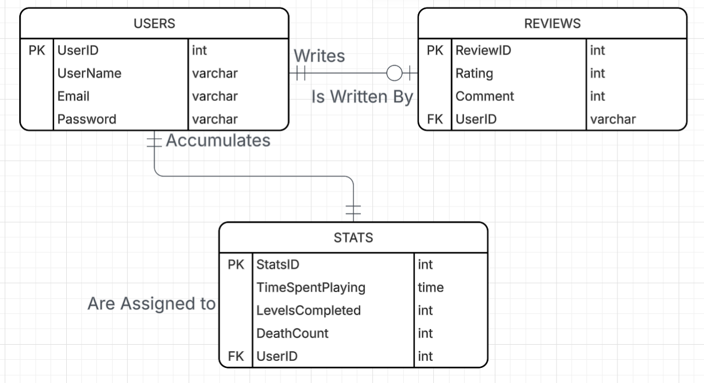
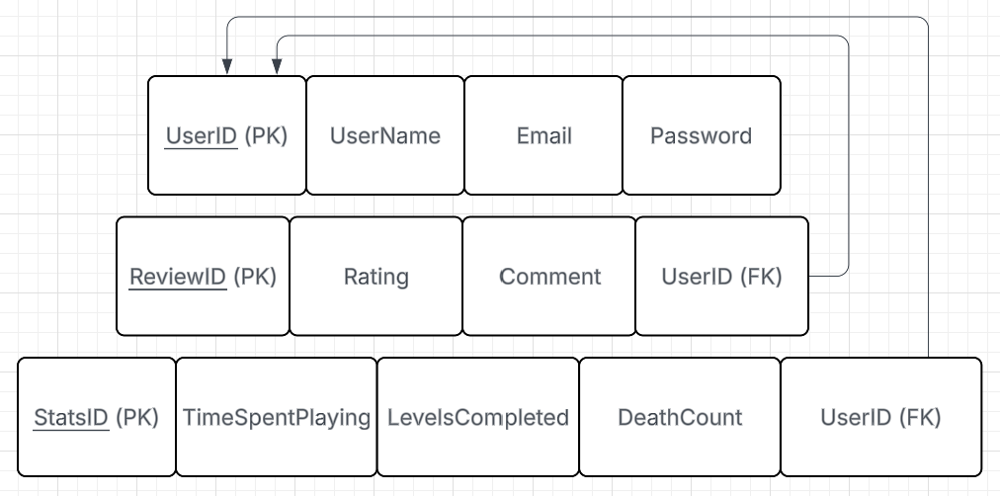
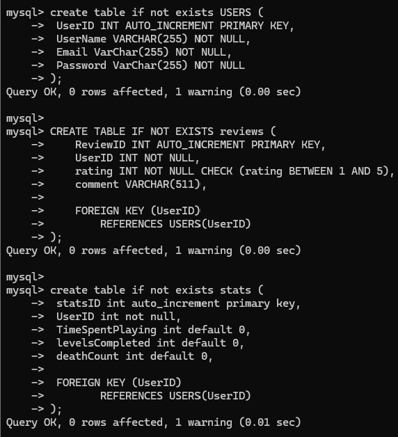

# wdp-project

#### Web and Database Programing Project

This project is intended to showcase my web dev journey, and my current game dev skills. To minimizing scope for our class assignment, this project is intended to funtional as a single itch page. There will be a playable in browser game that sends data to a db to be saved, and displayed on the web page.

## What Purpose does it Solve?

By combining somehting I am already interested in (game dev) with somehting I am currently learning (web dev), this project will serve as a fun way for me to persue both simultaniously.

## Who is the intended User?

The intended end users will be anyone who enjoys playing fun games.

## What Actions with Users be able to Preform

Users will be able to play the game in browser, leave a reivew, and have fun with friends!

## MVP ERD

To ensure I create a database that will meet the functional requirements of my system, I created a ERD that I will model the database off of.

## MVP Relations

To better understand how the tables present in my ERD connect, I created a relations diagram to show specificly what attributes in each table connect to each other.

## Database Implementation

For this assignment, I used MySQL as the relational database system. The tables I created are:
* USERS
* REVIEWS
* STATS

**USERS** - Stores user information like username, email, and passowrd.

**REVIEWS** - If the user rates the game or leaves a comment, that is stored here. Reviews are linked to UserIDs, so each user can only leave one review

**STATS** - Game stats will be stored here. Time playing the game, levels completed, and total deaths are stored and defaulted to 0. This is linked to UserID, so each player has individual stats tracked.

### SQL Tables

### Table Creation

